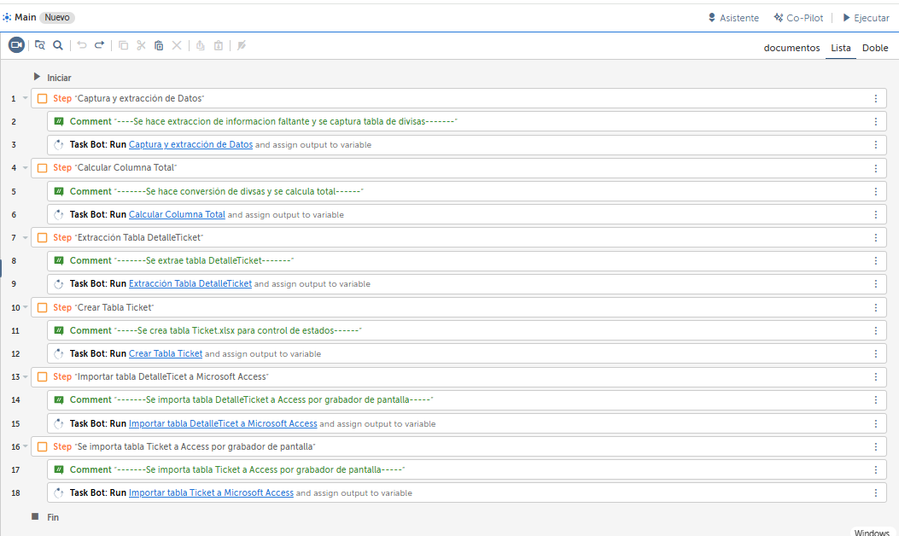

# Bot RPA — Orquestador `Main` (Automation 360)

Documentación del flujo principal `Main` desarrollado en Automation Anywhere Community Edition (Automation 360)[cite: 4, 5, 7]. Debido a las limitaciones de exportación de la edición Community, la lógica se documenta a partir de la secuencia de pasos y sub-TaskBots configurados en el editor[cite: 4, 5, 7].

[cite: 7, 34]

## Secuencia de ejecución (`Main`)

1. **Step "Captura y extracción de Datos":** Ejecuta el sub-TaskBot `Captura y extracción de Datos` para obtener información faltante y capturar la tabla de divisas[cite: 7].
2. **Step "Calcular Columna Total":** Ejecuta el sub-TaskBot `Calcular Columna Total` para realizar la conversión de divisas y calcular el total[cite: 7].
3. **Step "Extracción Tabla DetalleTicket":** Ejecuta el sub-TaskBot `Extracción Tabla DetalleTicket` para extraer los datos de la tabla `DetalleTicket`[cite: 7].
4. **Step "Crear Tabla Ticket":** Ejecuta el sub-TaskBot `Crear Tabla Ticket` para generar el archivo `Ticket.xlsx` destinado al control de estados[cite: 7].
5. **Step "Importar tabla DetalleTicet a Microsoft Access":** Ejecuta el sub-TaskBot `Importar tabla DetalleTicet a Microsoft Access` mediante grabador de pantalla para cargar la tabla en Microsoft Access[cite: 7].
6. **Step "Se importa tabla Ticket a Access por grabador de pantalla":** Ejecuta el sub-TaskBot `Importar tabla Ticket a Access` mediante grabador de pantalla para cargar la tabla de tickets en Microsoft Access[cite: 7].